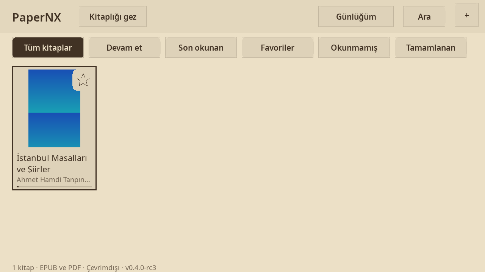
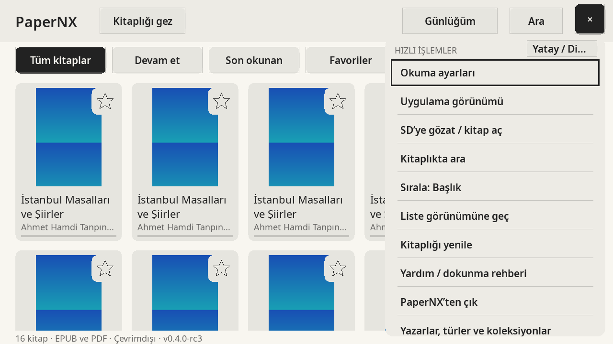
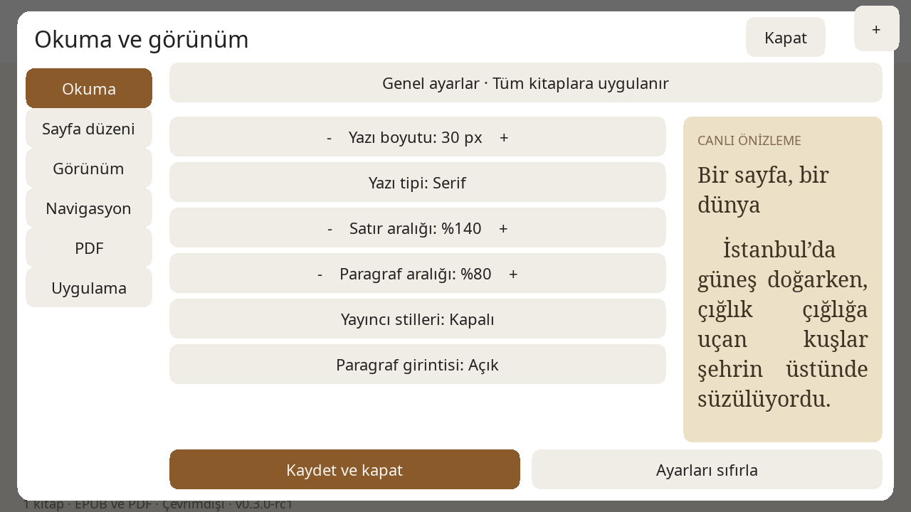
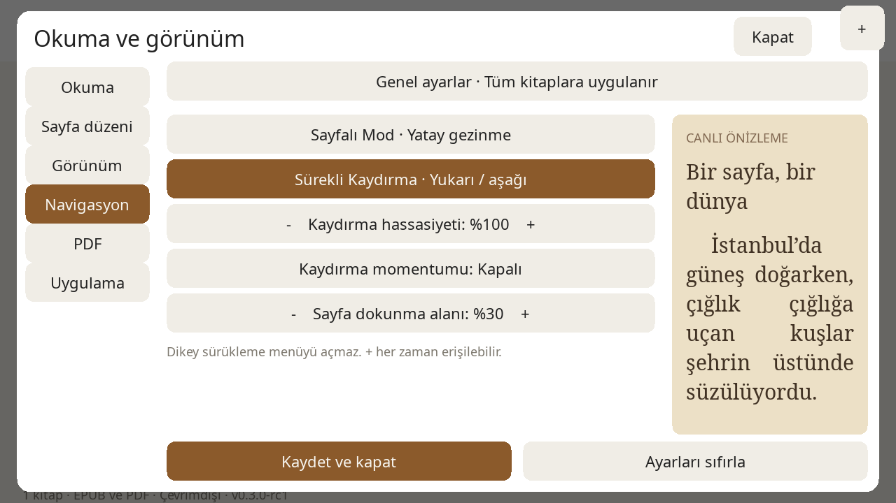
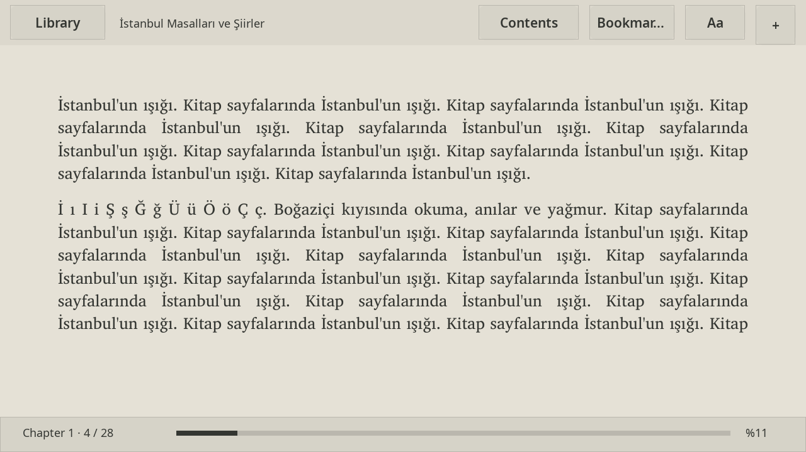

<p align="center"></p>

| **English** | [Türkçe](README.tr.md) |
|:---:|:---:|

# PaperNX

A **native, fully offline EPUB/PDF reader for Nintendo Switch**, built with C++17, SDL2, and MuPDF. Designed with a touchscreen-first interface for comfortable reading with the Joy-Con controllers detached. Books, covers, and reading records stay on your microSD card; no account, cloud service, or browser engine is required.

**v0.3.0-rc1 — candidate for device acceptance testing.** All desktop and Docker engineering gates (Core, Native, MuPDF, ASan/UBSan/LSan, and Release builds) have achieved **PASS (6/6)**. Physical Nintendo Switch hardware acceptance of this build is **UNVERIFIED**. Please consult the [release report](docs/RELEASE_REPORT.md) and [test results](docs/TEST_RESULTS.md) for full engineering evidence.

---

## Key Capabilities in v0.3

- **Touchscreen-First Ergonomics:** Always discoverable top-right `+` quick-action sheet across library, reader, and file browser. Large 56px minimum touch targets with visual feedback. Controllers remain supported as optional shortcuts.
- **Reading Preferences & Live Preview:** Comprehensive 6-section settings modal (Reading, Page Layout, Appearance, Navigation, PDF, Application) featuring an interactive live preview reflecting font family, size, line height, margins, alignment, paragraph spacing, and indentation.
- **Global & Per-Book Customization:** Shared global typography defaults apply to all books. Individual books can optionally be customized or reset to inherit global settings.
- **Genuine Continuous EPUB Scrolling:** Real pixel-by-pixel vertical scrolling with momentum, sensitivity adjustments, seamless chapter boundary transitions, and logical reading anchor preservation. Paginated horizontal reading mode remains fully supported.
- **Persistent Bounded Cover Cache:** Fast 150×210 RGB24 thumbnail cache bounded to 32 MiB / 512 entries on disk, with stat invalidation, checksum protection, automatic recovery, and immediate vector fallback artwork.
- **Curated Theme Palettes:** Paper, Ivory, Sepia, Slate, Dark, and OLED Black palettes tailored for Nintendo Switch LCD and OLED screens.
- **Bilingual Interface:** Real Turkish and English interface localization. Book metadata, TOC titles, and reading contents remain authentic and untranslated.
- **PDF Navigation:** Fit page, fit width, zoom, touch pan, and whole-page filters (Original, Dark, Sepia, Invert).
- **Data Safety:** Backward-compatible migration (PAPERNX-1..5 to PAPERNX-6) with immutable backups (`.pre-v6-vN.bak`) created prior to migration.

---

## Desktop Test Screenshots

Captured from the actual native application using SDL:


*Professional library view with category chips, vector favorite controls, and reading progress.*


*Discoverable contextual quick-action menu accessible by touch on any screen.*


*Generous settings panel with typography controls and real-time live preview.*


*Navigation controls: paginated mode vs. continuous vertical scroll mode.*


*Distraction-free reading view with touch-activated top and bottom toolbars.*

---

## Installation & Upgrade

1. Download the release package from `dist/v0.3.0-rc1/PaperNX-switch-v0.3.0-rc1.zip`.
2. Extract and merge the `switch/` directory into the root of your Switch microSD card.
3. Place your EPUB and PDF files in `switch/PaperNX/books/` or browse existing folders using **Browse SD**.
4. Launch PaperNX from the Homebrew Menu.

```text
sdmc:/switch/PaperNX/
├── PaperNX.nro
├── books/
├── data/
├── fonts/     (NotoSans-Regular.ttf, NotoSerif-Regular.ttf, OFL.txt)
├── licenses/
└── docs/
```

> [!IMPORTANT]
> The release ZIP only updates application executables, fonts, documentation, and license notices. It will **never overwrite** your existing books, reading records, bookmarks, or custom settings. Always preserve `books/` and `data/` when upgrading.

---

## Touch & Controller Navigation

Every essential action has a touch route. Physical controller bindings are optional shortcuts:

| Action | Touch Route | Controller Shortcut |
|---|---|---|
| **Quick Actions / Menu** | Tap top-right `+` button | Plus (+) |
| **Open Book** | Tap book card in library or row in browser | A |
| **Page Turns (Paginated EPUB)** | Tap left/right 30% zones or swipe horizontally | L / R, D-pad Left / Right |
| **Continuous EPUB Scroll** | Drag vertically up/down | Right stick / D-pad Up / Down |
| **Toggle Reader Toolbar** | Tap center reading zone | A |
| **Reading Settings (Aa)** | Tap `+` → Okuma ayarları / Reading settings | X |
| **Library Settings** | Tap `+` → Okuma ayarları (no book required) | X |
| **Application Appearance** | Tap `+` → Uygulama görünümü (Theme & Language) | Y |
| **PDF Zoom & Pan** | Tap −/+ in toolbar; drag zoomed page | ZL / ZR; Left stick |
| **Table of Contents** | Tap `+` → İçindekiler / Contents → select chapter | Minus (-) |
| **Bookmarks** | Tap `+` → Yer imleri / Bookmarks | Left shoulder click |
| **Favorite Book** | Tap star icon on library book card | Left stick click |
| **Return to Library** | Tap `+` → Kitaplığa dön / Return to library | B |
| **Exit Application** | Tap `+` → PaperNX’ten çık / Exit PaperNX | Home / B (in root) |

---

## Verification & Architecture

- **Test Evidence:** [docs/TEST_RESULTS.md](docs/TEST_RESULTS.md)
- **Product Roadmap:** [docs/PRODUCT_ROADMAP_2026.md](docs/PRODUCT_ROADMAP_2026.md)
- **Physical Acceptance Plan:** [docs/DEVICE_TEST_PLAN.md](docs/DEVICE_TEST_PLAN.md)
- **Design Tokens:** [docs/DESIGN_SYSTEM.md](docs/DESIGN_SYSTEM.md)
- **Known Issues:** [docs/KNOWN_ISSUES.md](docs/KNOWN_ISSUES.md)
