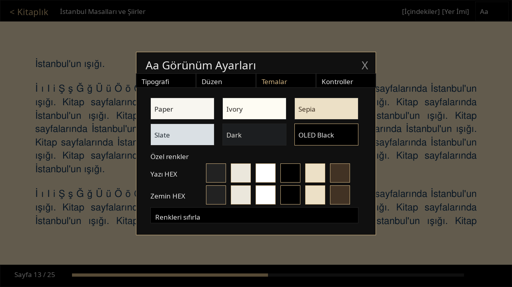
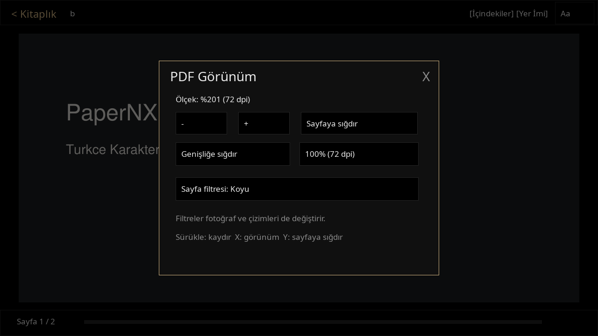
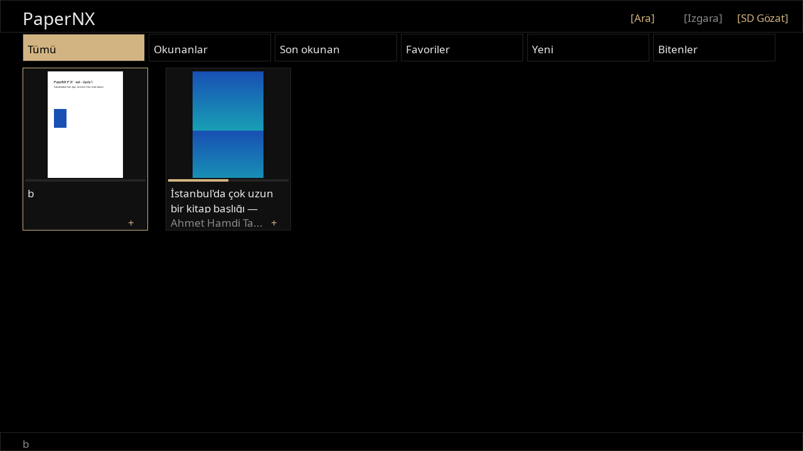

<p align="center"></p>

| [English](README.md) | **Türkçe** |
|:---:|:---:|

# PaperNX

Nintendo Switch için Türkçe arayüzlü, **native ve tamamen çevrimdışı EPUB/PDF okuyucu**. C++17, SDL2 ve MuPDF kullanır. Kitaplar ve kayıtlar microSD'dedir; hesap, sunucu veya tarayıcı motoru gerektirmez.

**v0.2.0-rc1 — cihaz kabul testine aday.** Önceki sürüm gerçek Switch'te denenmiş ve kayıt/dokunmatik sorunları bildirilmiştir. Bu dalın Docker ve paket sonuçları [test raporunda](docs/TEST_RESULTS.md); bu yeni yapının fiziksel Switch kabulü **UNVERIFIED**. Stable sürüm olarak değerlendirmeyin.

- EPUB: Serif/Sans/Yayıncı, boyut, satır ve paragraf aralığı, kenarlar, girinti, hizalama; Paper, Ivory, Sepia, Slate, Dark ve OLED Black.
- Yazı ve arka plan renklerini ayrı seçin; renk örnekleri veya altı haneli HEX kullanın. Düşük kontrast uyarısı vardır. Kitap ayarlarını varsayılan olarak kaydedebilirsiniz.
- PDF: sayfaya/genişliğe sığdırma, 72 dpi referanslı %100, yakınlaştırma ve sınırlı dokunmatik kaydırma. Orijinal, koyu, sepya ve ters renkler **tüm sayfa filtreleridir; fotoğrafları da değiştirir**.
- EPUB3 içindekiler, resimler ve kapaklar; yer imleri, favoriler, ilerleme, kitap başına ayarlar, arama ve SD gezgini.
- Altı kitaplık kategorisi, liste/ızgara, arka planda kapak yükleme, orantılı kapaklar ve çok satırlı başlıklar.
- Eski PAPERNX-1/2/3 kayıtlarını okuyabilir; yeni kayıt PAPERNX-4'tür. Yükseltmeden önce `data/` yedeği alın; eski sürüme dönüşte bu yedeği kullanın.

Gerçek uygulamadan SDL dummy video sürücüsüyle alınmış masaüstü test görüntüleri (Switch fotoğrafı değildir):





## SD kurulumu / yükseltme

1. Homebrew çalıştırabilen Switch kullanın. `dist/PaperNX-switch-v0.2.0-rc1.zip` içindeki `switch/` klasörünü microSD köküne birleştirin.
2. Kitaplarınızı `switch/PaperNX/books/` altına ekleyin veya **SD Gözat** ile başka klasörden açın.
3. Homebrew Menu'den PaperNX'i açın ve kapağa dokunun.

```text
switch/PaperNX/
  PaperNX.nro
  books/
  data/
  fonts/  (NotoSans-Regular.ttf, NotoSerif-Regular.ttf, OFL.txt)
  licenses/
```

Güncellemede klasörleri silmeyin. `books/`, `data/`, `logs/` ve kişisel fontlarınızı koruyun. ZIP kitap/kayıt/günlük içermez; yalnızca gerekli uygulama, font ve lisans dosyalarını günceller. SHA256 dosyaları `dist/` içindedir. Büyük PDF ve applet modunda kullanılabilir bellek sınırlıdır.

## Dokunmatik ve kumanda

| İşlem | Dokunmatik | Joy-Con / Pro Controller |
|---|---|---|
| Sonraki/önceki sayfa | Sağ/sol %30 kenar veya yatay kaydırma | L/R; normal görünümde sağ/sol |
| Araç çubuğu | Ortaya dokun | A |
| Ayarlar | Ortaya dokun → sağ üst **Aa** | + |
| Ayar alanı / sekme / değer | Düğmeye veya sekmeye dokun | Y / sol-sağ / yukarı-aşağı |
| HEX renk | Temalar → Yazı HEX / Zemin HEX | Temalar, Y ile renk alanı, yukarı/aşağı |
| Yer imi ekle/aç | Araçlar → Yer İmi → alt düğme / listedeki satır | Y ekle/kaldır; Minus liste |
| İçindekiler | Araçlar → İçindekiler → bölüm | X, yönler, A |
| PDF yakınlaştır / kaydır | Aa içindeki −/+; büyütülen sayfayı sürükle | ZL/ZR; sol çubuk |
| Kitaplığa dön | Araçlar → Kitaplık | B |
| Ara / SD gezgini | Üstte Ara / SD Gözat | X / Y |
| Favori | Kartın sağ altındaki + / F | Sol çubuk tık |
| Listede ilerle | Yukarı/aşağı kaydır | Yönler / çubuk |

Dokunmatik kenarlar Aa → Kontroller'den %20/30/40 seçilebilir. İki parmak yakınlaştırma SDL çoklu dokunma olaylarına bağlıdır; fiziksel Switch'te **UNVERIFIED**, −/+ güvenilir alternatif olarak sunulur. Masaüstünde HEX girişi Enter ile uygulanır, Esc ile iptal edilir.

## Yerel Docker doğrulaması

```sh
docker version
docker info
docker compose version
docker compose build desktop switch
docker compose run --rm desktop bash scripts/verify-final.sh
docker compose run --rm switch bash scripts/verify-switch.sh
```

Bu oturumda mevcut yerel `papernx-desktop` ve `papernx-switch` imajları kullanılmıştır; çalıştırılan komutların tam kaydı [doğrulama raporundadır](docs/TEST_RESULTS.md). MuPDF 1.23.11 kaynak SHA256 doğrulaması, native testler, ASan/UBSan, gerçek AArch64 ELF/NRO, ASET/NACP/RomFS/font ve ikon bayt kontrolü yapılır. Derleme araçları ağa ihtiyaç duyabilir; uygulama çalışma sırasında çevrimdışıdır.

Kayıt hatasında `switch/PaperNX/logs/papernx.log` dosyası işlem, yol, errno, native Result ve kurtarma kopyalarının durumunu içerir. Aynı hata tekrar tekrar bildirilmez; 6–60 saniye geri çekilerek yeniden denenir. Dokunma günlüğü Aa → Kontroller'den geçici açılır veya `data/touch-debug.flag` dosyasıyla etkinleştirilir. Testten sonra kapatın.

[Cihaz test planı](docs/DEVICE_TEST_PLAN.md) · [Teknik değişiklikler](docs/READER_V2.md) · [Switch derleme rehberi](docs/BUILD_SWITCH.md)

## Marka ve sosyal önizleme

Kullanıcının sağladığı dört dosya `assets/branding/` altında korunur. NRO ikonu `PaperNX-icon-switch.jpg`; README ikonu `PaperNX-icon-512.png` dosyasıdır. GitHub sosyal görseli hazırdır, ancak depo ayarı bu oturumda değiştirilmemiştir (**UNVERIFIED**): depo **Settings → General → Social preview → Edit → Upload an image** yolundan `assets/branding/PaperNX-github-social.png` yükleyip kaydedin.

## Lisans

PaperNX ve MuPDF **AGPL-3.0**, Noto fontları **SIL Open Font License** kapsamındadır. Paket kaynak/lisans yükümlülükleri ve bağımlılık bildirimleri için [LICENSE](LICENSE) ve [lisans rehberine](docs/LICENSES.md) bak.
