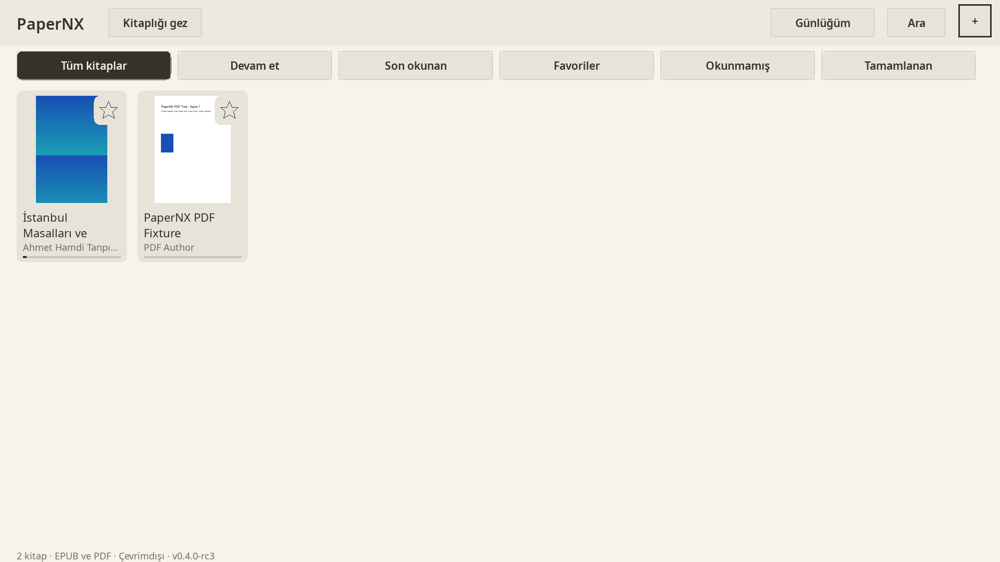
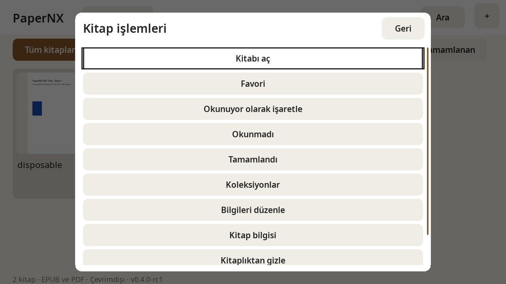
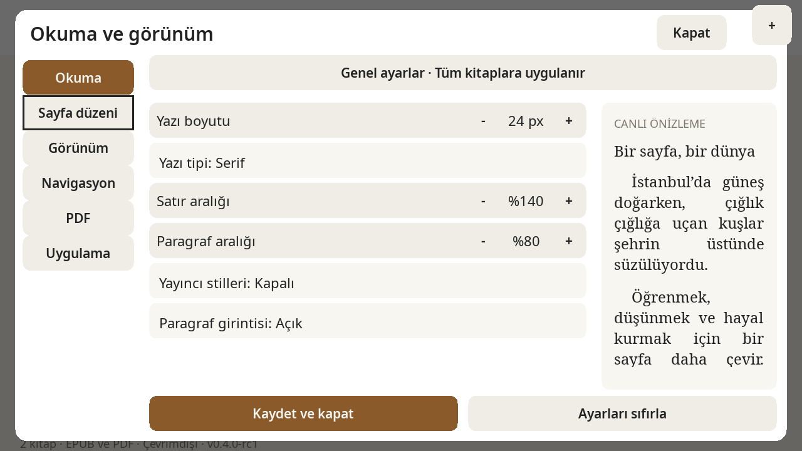
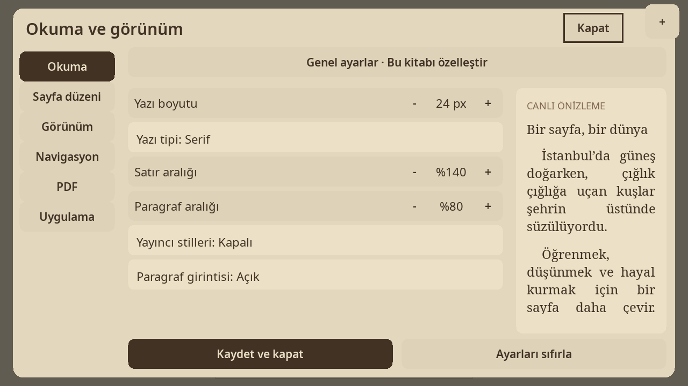
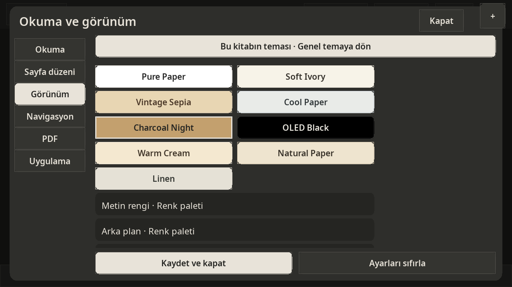

<p align="center"></p>

| [English](README.md) | **Türkçe** |
|:---:|:---:|

# PaperNX

Nintendo Switch için C++17, SDL2 ve MuPDF ile geliştirilmiş, **native ve tamamen çevrimdışı EPUB/PDF okuyucu**. Joy-Con kumandaları konsoldan ayrılmış durumdayken rahatça kitap okuyabilmeniz için dokunmatik odaklı olarak tasarlanmıştır. Kitaplarınız, kapak önbelleğiniz ve okuma kayıtlarınız doğrudan microSD kartınızda saklanır; hesap, bulut servisi veya web tarayıcı motoru gerektirmez.

**v0.4.0-rc1 — geliştirme sürüm adayı.** Güncel masaüstü, sanitizer, Release ve Switch çıktı kontrolleri [test sonuçlarında](docs/TEST_RESULTS.md) izlenir. Portre dahil yeni fiziksel Switch kabulü **UNVERIFIED** durumundadır. v0.3 sonuçları yeni adayı doğrulamaz.

---

## v0.4 değişiklikleri

Ortak tipografi ve ayrı ayar kontrolleri, okuma temasıyla uyumlu menüler, açık düzenleme modu, yakınlaştırılmış PDF sayfa hareketleri, portre döndürme, dokuz kâğıt önayarı ve görsel renk paleti eklendi. Kitaplık işlemleri, yazar/tür grupları, koleksiyonlar ve çevrimdışı istatistiklerin kapsamı [gereksinim tablosunda](docs/V04_REQUIREMENT_COVERAGE.md) izlenir. [Kontroller](docs/TOUCH_CONTROLS_V04.md), [veri modeli](docs/V04_LIBRARY_DATA_MODEL.md), [bilinen sınırlar](docs/KNOWN_ISSUES.md).

## Korunan v0.3 özellikleri

- **Dokunmatik Odaklı Ergonomi:** Kitaplık, okuyucu ve dosya tarayıcıda sağ üstte her zaman keşfedilebilir `+` hızlı işlem menüsü. 56px minimum dokunmatik hedef boyutu ve görsel basılma geri bildirimi. Kumandalar isteğe bağlı kısayollar olarak desteklenmeye devam eder.
- **Okuma Tercihleri ve Canlı Önizleme:** Yazı tipi, boyutu, satır aralığı, kenar boşlukları, hizalama, paragraf boşluğu ve girintiyi anlık yansıtan canlı Türkçe metin önizlemeli 6 sekmeli ayar paneli (Okuma, Sayfa Düzeni, Görünüm, Navigasyon, PDF, Uygulama).
- **Genel ve Kitap Başına Özelleştirme:** Paylaşılan genel tipografi ayarları tüm kitaplara uygulanır. İstediğiniz kitapta ayarları özelleştirebilir veya tek dokunuşla genel ayarlara geri dönebilirsiniz.
- **Gerçek Dikey Sürekli EPUB Kaydırma:** Sahte sayfa geçişleri yerine akıcı dikey piksel kaydırma, ayarlanabilir hassasiyet ve momentum, pürüzsüz bölüm geçişleri ve mantıksal okuma konumu (`anchor`) koruma. Sayfalı yatay okuma modu da eksiksiz korunmaktadır.
- **Disk Üzerinde Kalıcı Kapak Önbelleği:** 150×210 RGB24 boyutunda, diskte 32 MiB / 512 dosya ile sınırlandırılmış hızlı kapak önbelleği; dosya boyutu/tarihi ile geçersiz kılma, bozulma tespiti, otomatik kurtarma ve anında beliren şık vektörel yer tutucu kapaklar.
- **Tek Genel Tema:** Ayarlar → Uygulama → Genel Tema bölümünde dokuz doğal kâğıt önayarı. Kitaplık, üst menü, ayarlar, tüm pencereler ve EPUB aynı temayı kullanır. Kitaba özel görünüm yalnızca açıkça etkinleştirilirse devreye girer. PDF filtreleri belgeyi değiştirir, genel arayüz temasını değil.
- **Çift Dilli Arayüz:** Gerçek Türkçe ve İngilizce arayüz lokalizasyonu. Kitap içerikleri, başlıklar ve içindekiler özgün dillerinde korunur.
- **Gelişmiş PDF Navigasyonu:** Sayfaya sığdırma, genişliğe sığdırma, yakınlaştırma, dokunmatik serbest kaydırma ve tüm sayfa filtreleri (Orijinal, Koyu, Sepya, Ters).
- **Veri Güvenliği:** Eski kayıt biçimlerinden (PAPERNX-1..5) PAPERNX-6'ya güvenli yükseltme; yükseltme öncesinde değiştirilemez `.pre-v6-vN.bak` yedeği alma.

---

## Gerçek v0.4 masaüstü ekran görüntüleri

Doğrudan SDL uygulamasından alınmış gerçek ekran görüntüleri:


*Native kitaplık görünümü; masaüstü çizimi fiziksel Switch kabulü anlamına gelmez.*


*Kitaba uzun basarak veya kumandada X ile açılan kitap işlemleri.*


*Ayrı etiket/değer kontrolleri ve görünür kumanda odağı.*


*Okuma renkleriyle uyumlu ayar yüzeyleri.*


*Önceki v0.4 ekran görüntüsü: PDF sayfa filtresi artık genel arayüz temasından bağımsızdır. Yeni görünüm fiziksel Switch üzerinde ayrıca doğrulanacaktır.*

Portre çıktıları: [saat yönü](verification/screenshots/v04-portrait-cw-library.png), [saat yönünün tersi](verification/screenshots/v04-portrait-ccw-library.png). Görüntüyü konsolu tutacağınız yönde çevirin; uygulama çıktısı yazılımda bir kez döndürülür. Fiziksel portre testi **UNVERIFIED** durumundadır.

---

## SD Kurulumu ve Güncelleme

1. Sürüm paketini `dist/v0.4.0-rc1/PaperNX-switch-v0.4.0-rc1.zip` konumundan edinin.
2. Arşiv içindeki `switch/` klasörünü Switch microSD kartınızın ana dizinine kopyalayıp birleştirin.
3. EPUB ve PDF dosyalarınızı `switch/PaperNX/books/` altına ekleyin veya **SD Gözat** ile mevcut klasörlerden açın.
4. Homebrew Menu üzerinden PaperNX'i başlatın.

```text
sdmc:/switch/PaperNX/
├── PaperNX.nro
├── books/
├── data/
├── fonts/     (NotoSans-Regular.ttf, NotoSans-SemiBold.ttf, NotoSerif-Regular.ttf, OFL.txt)
├── licenses/
└── docs/
```

> [!IMPORTANT]
> Sürüm ZIP arşivi yalnızca uygulama dosyalarını, fontları, belgeleri ve lisans bildirimlerini günceller. Mevcut kitaplarınızın, okuma kayıtlarınızın, yer imlerinizin veya ayarlarınızın üzerine **asla yazmaz**. Güncelleme sırasında `books/` ve `data/` klasörlerinizi daima koruyun.

---

## Dokunmatik ve Kumanda Yönlendirmesi

Tüm temel işlevler için dokunmatik yol mevcuttur; fiziksel kumandalar isteğe bağlı kısayollardır:

| İşlem | Dokunmatik Yol | Kumanda Kısayolu |
|---|---|---|
| **Hızlı Menü / İşlemler** | Sağ üstteki `+` butonuna dokunun | Plus (+) |
| **Kitap Açma** | Kitaplıkta karta veya gezginde satıra dokunun | A |
| **Sayfa Çevirme (Sayfalı EPUB)** | Sağ/sol %30 kenara dokunun veya yatay kaydırın | L / R, D-pad Sol / Sağ |
| **Sürekli EPUB Kaydırma** | Yukarı/aşağı dikey sürükleyin | Sağ çubuk / D-pad Yukarı / Aşağı |
| **Okuyucu Araç Çubuğu** | Sayfanın ortasına dokunun | A |
| **Okuma Ayarları (Aa)** | `+` → Okuma ayarları | X |
| **Kitaplık Ayarları** | Kitaplıkta `+` → Okuma ayarları (kitap gerekmez) | X |
| **Uygulama Görünümü** | `+` → Uygulama görünümü (Tema ve Dil) | Y |
| **PDF Yakınlaştırma ve Kaydırma** | Araç çubuğunda −/+, büyütülmüş sayfayı sürükleyin | ZL / ZR; Sol çubuk |
| **İçindekiler** | `+` → İçindekiler → bölüm seçin | Minus (-) |
| **Yer İmleri** | `+` → Yer imleri | Sol omuz tık |
| **Favorilere Ekle** | Kitap kartındaki yıldız simgesine dokunun | Sol çubuk tık |
| **Kitaplığa Dön** | `+` → Kitaplığa dön | B |
| **Uygulamadan Çıkış** | `+` → PaperNX’ten çık | Home / B (kök ekranda) |

---

## Doğrulama ve Mimari Belgeleri

- **Test Sonuçları:** [docs/TEST_RESULTS.md](docs/TEST_RESULTS.md)
- **Ürün Yol Haritası (2026):** [docs/PRODUCT_ROADMAP_2026.md](docs/PRODUCT_ROADMAP_2026.md)
- **Fiziksel Test Planı:** [docs/DEVICE_TEST_PLAN.md](docs/DEVICE_TEST_PLAN.md)
- **Tasarım Sistemi ve Tokenlar:** [docs/DESIGN_SYSTEM.md](docs/DESIGN_SYSTEM.md)
- **Bilinen Durumlar:** [docs/KNOWN_ISSUES.md](docs/KNOWN_ISSUES.md)
